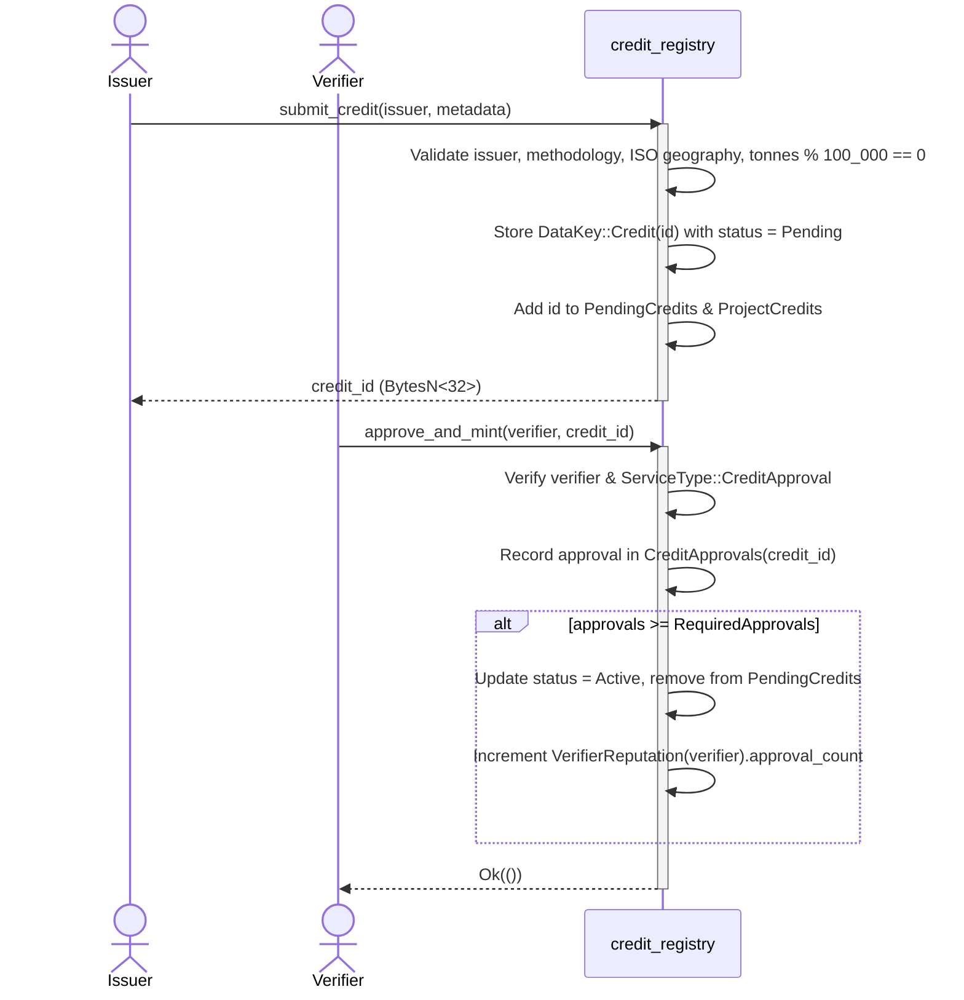
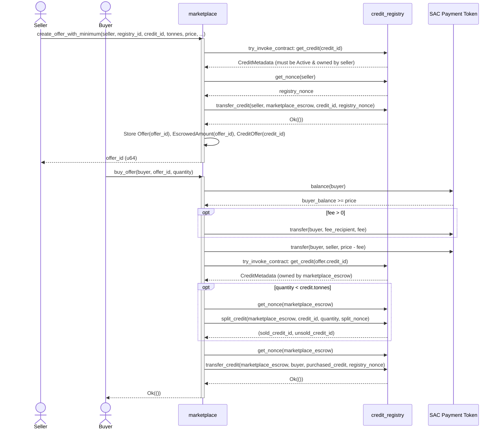
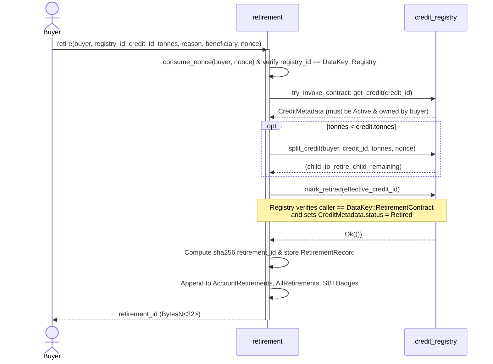
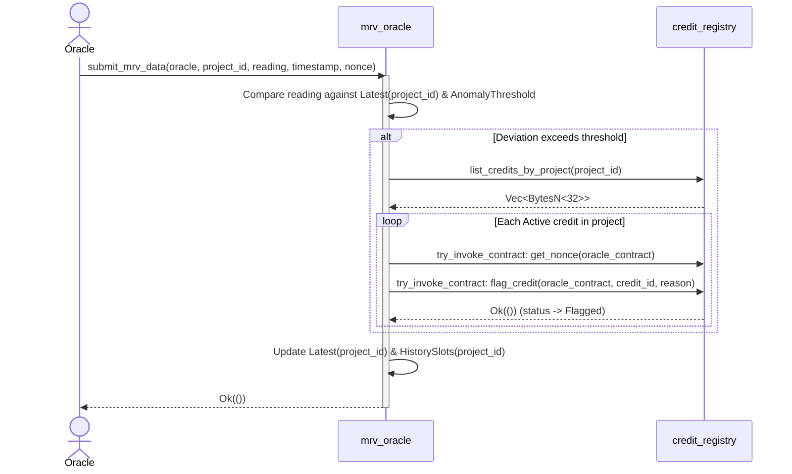

# Soroban Contract State-Machine & Data Storage Architecture

This guide documents the on-chain lifecycle of a CarbonChain carbon credit, how `DataKey` storage variants are laid out across all four Soroban contracts, and how cross-contract invocations coordinate state transitions.

> **Related:** See [storage-layout.md](storage-layout.md) for `DataKey` discriminant ordering and schema migration rules.

---

## 1. Carbon Credit Lifecycle State Machine

A carbon credit's on-chain status is governed by `CreditStatus` in `contracts/credit_registry/src/types.rs`:

| Variant | Discriminant | Description |
|---|---:|---|
| `Pending` | `0` | Submitted by a registered issuer via `submit_credit`; awaiting verifier approval(s). |
| `Active` | `1` | Approved by the required number of verifiers (`approve_and_mint`); transferable, splittable, mergeable, listable, and retirable. |
| `Retired` | `2` | Permanently burned via `retirement::retire` → `credit_registry::mark_retired`. Terminal state. |
| `Flagged` | `3` | Flagged for anomaly/audit via `flag_credit` (by a verifier, admin, or `mrv_oracle`). |
| `Disputed` | `4` | Placed into formal dispute via `dispute_credit` with supporting evidence. |
| `Expired` | `5` | Marked expired via `expire_credit` after exceeding `MaxVintageAge`. Terminal state. |

> **Note on "Listed" state:** Listing a credit on the marketplace does **not** introduce a new `CreditStatus` variant. Instead, `marketplace::create_offer` transfers the `Active` credit's ownership to the marketplace contract's escrow address via `credit_registry::transfer_credit` and records an `Offer` + `EscrowedAmount` + `CreditOffer` reverse index. Cancelling or reclaiming an expired offer transfers ownership back to the seller; buying transfers ownership to the buyer.

```mermaid
stateDiagram-v2
    [*] --> Pending : submit_credit()

    Pending --> Pending : approve_and_mint()\n[approvals < RequiredApprovals]
    Pending --> Active : approve_and_mint()\n[approvals >= RequiredApprovals]
    Pending --> Flagged : flag_credit()

    state "Active (On-Chain)" as Active {
        [*] --> HeldByOwner
        HeldByOwner --> ListedInEscrow : marketplace::create_offer()\n[transfer_credit to marketplace]
        ListedInEscrow --> HeldByOwner : cancel_offer() / reclaim_expired_offer()\n[transfer_credit to seller]
        ListedInEscrow --> HeldByOwner : buy_offer()\n[transfer_credit to buyer]
        HeldByOwner --> HeldByOwner : transfer_credit() / split_credit() / merge_credits()
    }

    Active --> Retired : retirement::retire()\n-> mark_retired()
    Active --> Flagged : flag_credit()\n[verifier / admin / mrv_oracle]
    Active --> Disputed : dispute_credit()
    Active --> Expired : expire_credit()\n[vintage age > MaxVintageAge]

    Flagged --> Active : resolve_flag(Rejected)
    Flagged --> Disputed : dispute_credit()

    Disputed --> Active : resolve_dispute(Rejected)
    Disputed --> Flagged : resolve_dispute(Confirmed)

    Retired --> [*]
    Expired --> [*]
```

---

## 2. Storage Architecture & `DataKey` Mappings

All contracts use Soroban's two primary ledger storage tiers:
- **Instance storage** (`env.storage().instance()`): Contract-wide configuration, admin pointers, and small global sets/counters that share the contract instance's TTL.
- **Persistent storage** (`env.storage().persistent()`): Per-entity records (credits, offers, retirements, nonces, per-address indexes) with independent TTLs extended on write via `extend_ttl(TTL_THRESHOLD, MIN_TTL)` where `MIN_TTL = 6_307_200` ledgers (~1 year at 5s/ledger) and `TTL_THRESHOLD = MIN_TTL / 2`.

> **CRITICAL:** Never reorder or remove existing `DataKey` enum variants. Variant declaration order determines the XDR discriminant prefix on the ledger. Always append new variants to the end of the enum.

### 2.1 `credit_registry` (`contracts/credit_registry/src/types.rs`)

| `DataKey` Variant | Tier | Value Type | Purpose |
|---|---|---|---|
| `Version` | Instance | `u32` | Schema version for sequential `migrations::run_migrations`. |
| `Admin` | Instance | `Address` | Current contract administrator. |
| `PendingAdmin` | Instance | `Address` | Candidate admin for two-step `propose_admin` / `accept_admin`. |
| `Paused` | Instance | `bool` | Emergency pause flag. |
| `VerifierSet` | Instance | `Vec<Address>` | Registered verifier addresses. |
| `IssuerSet` | Instance | `Vec<Address>` | Authorized credit issuer addresses. |
| `MethodologySet` | Instance | `Vec<Methodology>` | Approved carbon methodologies. |
| `RetirementContract` | Instance | `Address` | Trusted `retirement` contract authorized to call `mark_retired`. |
| `RequiredApprovals` | Instance | `u32` | Verifier approvals required before `Pending -> Active`. |
| `CreditNonce` | Instance | `u64` | Legacy pre-#681 credit ID nonce (preserved for compatibility). |
| `SubmitCreditNonce` | Instance | `u64` | Namespaced nonce for `submit_credit` ID generation. |
| `SplitCreditNonce` | Instance | `u64` | Namespaced nonce for `split_credit` child IDs. |
| `MergeCreditNonce` | Instance | `u64` | Namespaced nonce for `merge_credits` merged ID. |
| `AuditLogCount` | Instance | `u64` | Monotonic counter for `AuditLog` entries. |
| `SessionCount` | Instance | `u64` | Monotonic counter for `Session` IDs (separate from `AuditLogCount`). |
| `NextVerifierId` | Instance | `u32` | Counter for assigning compact numeric `VerifierId`s. |
| `PendingCredits` | Instance | `Vec<BytesN<32>>` | Global list of credit IDs currently in `Pending` status. |
| `TotalCredits` | Instance | `u64` | Total credits ever submitted (O(1) count). |
| `MinStake` | Instance | `i128` | Minimum stake required to register as a verifier. |
| `ApprovedStakeToken` | Instance | `Address` | SAC token contract accepted for verifier staking. |
| `MaxVintageAge` | Instance | `u32` | Maximum permitted credit vintage age in calendar years. |
| `Credit(BytesN<32>)` | Persistent | `CreditMetadata` | Core credit record (issuer, owner, tonnes, status, royalty, etc.). |
| `Project(String)` | Persistent | `ProjectMetadata` | Project profile metadata keyed by `project_id`. |
| `ProjectCredits(String)` | Persistent | `Vec<BytesN<32>>` | Credit IDs associated with a `project_id`. |
| `CreditByProjectVintage(String, u32)` | Persistent | `Vec<BytesN<32>>` | Credits indexed by `(project_id, vintage_year)`. |
| `CreditsByOwner(Address)` | Persistent | `Vec<BytesN<32>>` / paged | Credits owned by `Address`. |
| `PendingCreditsByVerifier(Address)` | Persistent | `Vec<BytesN<32>>` / paged | Pending credits assigned to a verifier. |
| `CreditApprovals(BytesN<32>)` | Persistent | `Vec<Address>` / bitmap | Verifiers who have approved a given `credit_id`. |
| `CreditVerifiers(BytesN<32>)` | Persistent | `Vec<Address>` | Snapshot of verifiers assigned at submission time. |
| `Dispute(BytesN<32>)` | Persistent | Dispute struct | Dispute evidence and metadata keyed by `credit_id`. |
| `Nonce(Address)` | Persistent | `u64` | Replay-protection nonce per address. |
| `NonceBitmap(Address)` | Persistent | `u128` / bitmap | Sliding-window nonce bitmap for out-of-order replay protection. |
| `VerifierReputation(Address)` | Persistent | `VerifierReputation` | `approval_count` and `dispute_count` per verifier. |
| `VerifierPendingCount(Address)` | Persistent | `u64` | Count of `Pending` credits assigned to a verifier. |
| `VerifierServices(Address)` | Persistent | `Vec<ServiceType>` | Self-configured verifier capabilities (`CreditApproval`, `MRVReview`). |
| `VerifierId(Address)` | Persistent | `u32` | Stable numeric ID assigned to a verifier on registration. |
| `VerifierStake(Address)` | Persistent | `i128` | Locked stake amount for a verifier. |
| `VerifierStakeToken(Address)` | Persistent | `Address` | Token contract deposited as stake by the verifier. |
| `UnbondingRequest(Address)` | Persistent | `UnbondingRequest` | Pending stake withdrawal (`amount`, `unlock_at`) after `remove_verifier`. |
| `Session(BytesN<32>)` | Persistent | `Session` | Compliance session metadata (`initiator`, `created_at`, `operation_count`). |
| `SessionOpCount(BytesN<32>)` | Persistent | `u64` | Operation count within a session. |
| `AuditLog(BytesN<32>)` | Persistent | `AuditLogEntry` | Immutable audit log entry keyed by log ID. |

### 2.2 `marketplace` (`contracts/marketplace/src/lib.rs`)

| `DataKey` Variant | Tier | Value Type | Purpose |
|---|---|---|---|
| `Admin` | Instance | `Address` | Marketplace administrator. |
| `Paused` | Instance | `bool` | Emergency pause flag. |
| `TrustedRegistry` | Instance | `Address` | Trusted `credit_registry` contract address bound at initialization. |
| `AllowedToken` | Instance | `Address` | Legacy single payment token address. |
| `AllowedTokens` | Instance | `Vec<Address>` | Admin-approved SAC payment token addresses. |
| `OfferCount` | Instance | `u64` | Monotonic offer ID counter. |
| `ActiveOffers` | Instance | `Vec<u64>` | List of currently active offer IDs. |
| `ActiveOffersCount` | Instance | `u64` | Count of active offers. |
| `MinPrice` | Instance | `i128` | Minimum permitted unit price. |
| `Version` | Instance | `u32` | Contract schema version. |
| `TotalVolumeXLM` | Instance | `i128` | Cumulative XLM trade volume. |
| `TotalVolumeTokens` | Instance | `Map<Address, i128>` | Cumulative per-token trade volume. |
| `FeeBps` | Instance | `u32` | Platform fee in basis points (default `0`). |
| `FeeRecipient` | Instance | `Address` | Treasury address receiving platform fees. |
| `Offer(u64)` | Persistent | `Offer` | Listing details (seller, `credit_id`, `tonnes`, price, asset, expiry). |
| `EscrowedAmount(u64)` | Persistent | `i128` | Escrowed credit tonnes for `offer_id`. |
| `SellerOffers(Address)` | Persistent | `Vec<u64>` | Offer IDs created by `seller`. |
| `CreditOffer(BytesN<32>)` | Persistent | `u64` | Reverse index mapping `credit_id -> offer_id` for O(1) lookup. |
| `Nonce(Address)` | Persistent | `u64` | Per-address replay-protection nonce. |
| `NonceBitmap(Address)` | Persistent | `u128` / bitmap | Per-address sliding-window nonce bitmap. |

### 2.3 `retirement` (`contracts/retirement/src/types.rs`)

| `DataKey` Variant | Tier | Value Type | Purpose |
|---|---|---|---|
| `Admin` | Instance | `Address` | Retirement contract administrator. |
| `PendingAdmin` | Instance | `Address` | Candidate admin for two-step transfer. |
| `Paused` | Instance | `bool` | Emergency pause flag. |
| `Registry` | Instance | `Address` | Trusted `credit_registry` contract address. |
| `Version` | Instance | `u32` | Contract schema version. |
| `AllRetirements` | Instance | `Vec<BytesN<32>>` | Global index of all retirement IDs for admin auditing. |
| `Retirement(BytesN<32>)` | Persistent | `RetirementRecord` | Immutable retirement receipt (`credit_id`, `buyer`, `tonnes_retired`, `reason`, `beneficiary`, `vintage_year`, `certificate_fingerprint`). |
| `AccountRetirements(Address)` | Persistent | `Vec<BytesN<32>>` | Retirement IDs belonging to `buyer`. |
| `CertificateHash(BytesN<32>)` | Persistent | `String` | Off-chain PDF IPFS CID set via `set_certificate_hash`. |
| `SBTBadges(Address)` | Persistent | `Vec<BytesN<32>>` | Soulbound Token (non-transferable) retirement badge IDs per buyer. |
| `Nonce(Address)` | Persistent | `u64` | Per-address replay-protection nonce. |
| `NonceBitmap(Address)` | Persistent | `u128` / bitmap | Per-address sliding-window nonce bitmap. |

### 2.4 `mrv_oracle` (`contracts/mrv_oracle/src/lib.rs`)

| `DataKey` Variant | Tier | Value Type | Purpose |
|---|---|---|---|
| `Admin` | Instance | `Address` | Oracle administrator. |
| `PendingAdmin` | Instance | `Address` | Candidate admin for two-step transfer. |
| `Paused` | Instance | `bool` | Emergency pause flag. |
| `OracleSet` | Instance | `Vec<Address>` | Authorized MRV oracle addresses. |
| `TrustedRegistry` | Instance | `Address` | Trusted `credit_registry` contract address. |
| `AnomalyThreshold` | Instance | `u32` | Global anomaly threshold in basis points (default `2000` = 20%). |
| `Latest(String)` | Persistent | `MrvDataPoint` | Latest MRV reading keyed by `project_id`. |
| `History(String)` | Persistent | `Vec<MrvDataPoint>` | Full MRV reading history per `project_id`. |
| `HistorySlots(String)` | Persistent | Ring buffer slots | Bounded ring buffer slots for per-project MRV history. |
| `HistoryMeta(String)` | Persistent | Ring buffer meta | Head pointer and count for per-project MRV ring buffer. |
| `ProjectAnomalyThreshold(String)` | Persistent | `u32` | Per-project anomaly threshold override (bps). |
| `MethodologyThreshold(Symbol)` | Persistent | `u32` | Per-methodology anomaly threshold override (bps). |
| `OracleRep(Address)` | Persistent | `OracleReputation` | Oracle reputation score, dispute count, and deregistration flag. |
| `Nonce(Address)` | Persistent | `u64` | Per-address replay-protection nonce. |
| `NonceBitmap(Address)` | Persistent | `u128` / bitmap | Per-address sliding-window nonce bitmap. |

---

## 3. Cross-Contract Call Sequence Charts

### 3.1 Credit Issuance & Verifier Approval



### 3.2 Marketplace Listing & Purchase (with Partial Fill Split)



### 3.3 Carbon Credit Retirement



### 3.4 MRV Oracle Anomaly Detection


